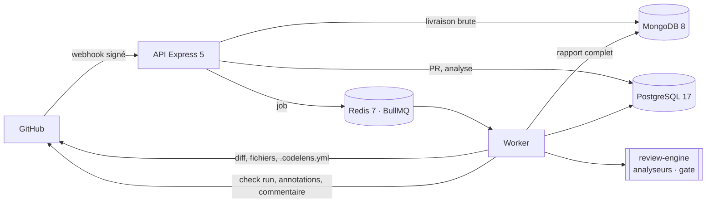

# CodeLens

[](https://github.com/KarnasZiad/CodeLens/actions/workflows/ci.yml)
[](https://github.com/KarnasZiad/CodeLens/actions/workflows/security.yml)
[](LICENSE)

**GitHub App de revue de code automatisée** : à chaque push sur une pull request, CodeLens analyse
les lignes modifiées, annote les problèmes directement sur le diff, publie un commentaire de
synthèse et applique une _quality gate_ qui peut bloquer la fusion.

> Projet de portfolio qui illustre la mission « revue de code » : le moteur d'analyse est extensible
> (patron Strategy), testé sur des diffs réels, et l'outil applique à lui-même les règles qu'il
> fait respecter.

## Sommaire

- [Ce que fait CodeLens](#ce-que-fait-codelens)
- [Architecture](#architecture)
- [Démarrage rapide](#démarrage-rapide)
- [Configuration d'un dépôt](#configuration-dun-dépôt)
- [Sécurité](#sécurité)
- [Tests et qualité](#tests-et-qualité)
- [Feuille de route](#feuille-de-route)

## Ce que fait CodeLens

| Règle                         | Sévérité par défaut | Exemple                                         |
| ----------------------------- | ------------------- | ----------------------------------------------- |
| Secrets commités              | bloquant            | clé AWS, jeton GitHub ou Slack, clé privée PEM  |
| Injection SQL                 | critique            | ``pool.query(`SELECT … ${id}`)``                |
| Test focalisé                 | critique            | `it.only(…)` qui désactive le reste de la suite |
| Débogage oublié               | majeur, mineur      | `debugger;`, `console.log`, `breakpoint()`      |
| Complexité cyclomatique       | majeur              | fonction modifiée au-delà de 10 branches        |
| Lockfile non mis à jour       | majeur              | `package.json` modifié seul                     |
| Taille de PR, tests manquants | mineur              | plus de 400 lignes, code ajouté sans test       |
| TODO sans ticket, dépendances | info                | `// TODO plus tard`, nouvelle dépendance npm    |

Catalogue complet et justification de chaque règle : [docs/analyzers.md](docs/analyzers.md).

Ce que voit le développeur dans sa PR :

- un check **CodeLens** `in_progress`, puis `success` ou `failure` selon la quality gate ;
- une **annotation** sur chaque ligne concernée (`failure`, `warning` ou `notice`) ;
- un **commentaire de synthèse** unique, mis à jour à chaque push.

## Architecture



| Élément                  | Rôle                                                                      |
| ------------------------ | ------------------------------------------------------------------------- |
| `packages/review-engine` | Moteur pur : parseur de diff, analyseurs, quality gate, rendu Markdown    |
| `apps/api` (`main.ts`)   | Webhooks : signature, dédoublonnage, synchronisation, mise en file        |
| `apps/api` (`worker.ts`) | Analyses : GitHub App, moteur, publication ; reprises et limites de débit |

Le webhook répond en quelques millisecondes ; l'analyse se fait dans le worker
([ADR 0003](docs/adr/0003-analyse-asynchrone-bullmq.md)). Détails : [C4](docs/architecture/c4.md),
[pipeline de revue](docs/architecture/review-pipeline.md), [modèle de données](docs/database.md),
[ADR](docs/adr/0001-enregistrer-les-decisions-d-architecture.md).

| Couche  | Technologies                                                                  |
| ------- | ----------------------------------------------------------------------------- |
| Serveur | Node.js 22, Express 5, BullMQ 5, Octokit (GitHub App), Zod 4, Pino            |
| Moteur  | TypeScript compiler API (complexité), YAML, picomatch                         |
| Données | PostgreSQL 17 (Drizzle ORM), MongoDB 8 (TTL), Redis 7                         |
| Tests   | Vitest, Supertest, Testcontainers                                             |
| CI/CD   | GitHub Actions, CodeQL, Trivy, revue des dépendances, Dependabot, images GHCR |

## Démarrage rapide

Prérequis : Node.js 22, Docker et pnpm via Corepack (`corepack enable`).

```bash
pnpm install
docker compose up -d                        # PostgreSQL, MongoDB, Redis
cp apps/api/.env.example apps/api/.env      # secret du webhook, identifiant et clé de l'app
pnpm --filter @codelens/api db:migrate
pnpm --filter @codelens/api dev             # API sur http://localhost:3000
pnpm --filter @codelens/api dev:worker      # worker
```

### Créer la GitHub App

1. Sur GitHub, **Settings → Developer settings → GitHub Apps → New GitHub App**, en reprenant les
   permissions et l'événement de [`github-app-manifest.json`](github-app-manifest.json) :
   `checks: write`, `pull_requests: write`, `contents: read`, `metadata: read`, événement
   `pull_request`.
2. Générer un **secret de webhook** et une **clé privée** ; placer la clé hors du dépôt (`*.pem` est
   ignoré par Git) et renseigner `GITHUB_APP_ID`, `GITHUB_PRIVATE_KEY_FILE` et
   `GITHUB_WEBHOOK_SECRETS`.
3. En local, relayer les webhooks vers l'API, par exemple avec
   `npx smee-client --url https://smee.io/<canal> --target http://localhost:3000/webhooks/github`.
4. Installer l'app sur un dépôt de test et ouvrir une pull request.

Pile complète depuis le Dockerfile : `cp .env.example .env`, puis
`docker compose --profile app up -d --build`.

## Configuration d'un dépôt

Un fichier `.codelens.yml` à la racine du dépôt ajuste les règles. Il est **lu sur la branche de
base** de la PR : une PR ne peut pas assouplir les règles qui la jugent.

```yaml
ignore: ['**/*.generated.ts']
analyzers:
  complexity:
    threshold: 15
  todo-comments:
    enabled: false
gate:
  maxFindings:
    major: 5 # en plus des valeurs par défaut : aucun bloquant, aucun critique
```

Une configuration invalide donne un check `neutral` qui liste chaque erreur avec sa ligne.

## Sécurité

[Modèle de menaces STRIDE](docs/security/threat-model.md) : 18 menaces, leurs mesures et les
risques résiduels. Quelques choix notables :

- **Webhook authentifié avant tout traitement** : HMAC-SHA256 du corps brut, comparaison en temps
  constant, plusieurs secrets actifs pour une rotation sans interruption.
- **Le code analysé n'est jamais exécuté** : ni installation, ni compilation ; la complexité est
  calculée sur l'arbre syntaxique seul ([ADR 0005](docs/adr/0005-moteur-d-analyse-pur-et-extensible.md)).
- **Un secret détecté n'est jamais recopié** : le constat donne le type et la ligne, pas la valeur.
- **Permissions minimales** et jetons d'installation d'une heure ([ADR 0002](docs/adr/0002-github-app.md)).
- **Échec ouvert sur panne, fermé sur la gate** : une panne de CodeLens donne un check `neutral`,
  qui ne bloque jamais une fusion.

## Tests et qualité

```bash
pnpm test:coverage       # moteur et API, seuils de couverture (80 à 90 %)
pnpm test:integration    # PostgreSQL, MongoDB et Redis réels (Docker requis)
```

| Niveau      | Exemples                                                                                          |
| ----------- | ------------------------------------------------------------------------------------------------- |
| Moteur      | Diffs GitHub réels, secrets jamais recopiés, tagged templates SQL, lignes piégées contre le ReDoS |
| HTTP        | Signature forgée, corps altéré, rotation de secret, 413, doublons, rejeu après panne              |
| Adaptateur  | Octokit avec une vraie clé RSA : jeton d'installation, pagination, lots de 50 annotations         |
| Intégration | Migrations concurrentes, une analyse par commit, cascade, TTL, webhook → BullMQ → check publié    |

Chaque pull request passe par la CI (format, lint, typecheck, tests et couverture, build, tests
d'intégration, image Docker scannée, CodeQL, Trivy, revue des dépendances) et par la checklist du
[template de PR](.github/pull_request_template.md).

## Feuille de route

- [x] Conception : cahier des charges, user stories, C4, STRIDE, ADR
- [x] Moteur d'analyse : diff, 8 analyseurs, quality gate, rendu Markdown
- [x] Webhooks signés, file BullMQ, worker GitHub App, check runs, annotations, commentaire
- [ ] Tableau de bord Next.js : connexion GitHub, dépôts, PR, tendances
- [ ] Commande `/codelens recheck` et bouton « Re-run » du check
- [ ] Adaptateur GitLab (merge requests, discussions)
- [ ] Analyseurs Python et Go via tree-sitter, suggestions de correction
