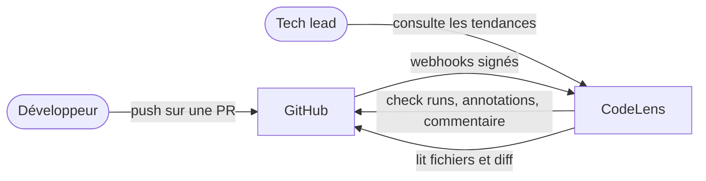
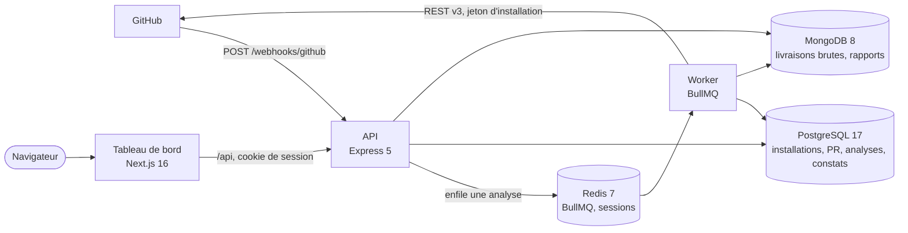
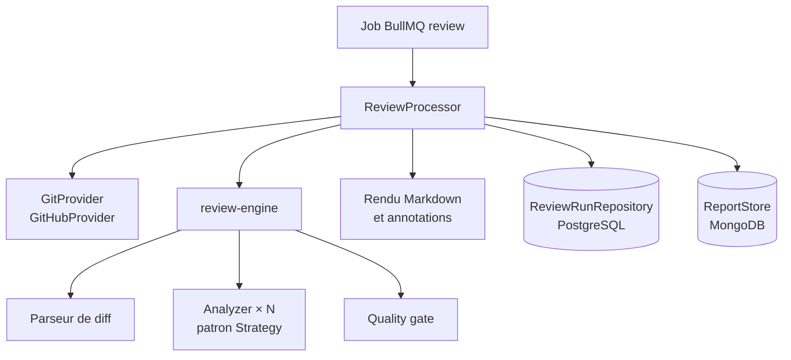

# Architecture C4

## Niveau 1 — Contexte

CodeLens est une GitHub App : GitHub lui envoie les événements des dépôts où elle est installée, et
elle agit avec un jeton d'installation limité à ces dépôts et aux permissions déclarées.

## Niveau 2 — Conteneurs

| Conteneur       | Responsabilité                                                                         |
| --------------- | -------------------------------------------------------------------------------------- |
| API             | Vérifie et accuse les webhooks, synchronise les installations, sert le tableau de bord |
| Worker          | Exécute les analyses : diff, configuration, moteur, publication sur GitHub             |
| Tableau de bord | Pages rendues côté serveur ; l'API est relayée sur la même origine                     |
| PostgreSQL      | Données relationnelles requêtées par le tableau de bord, agrégats de tendance          |
| MongoDB         | Livraisons de webhooks (TTL 7 jours) et rapports complets (TTL 90 jours)               |
| Redis           | File BullMQ, limitation de débit, sessions du tableau de bord                          |

L'API et le worker sont deux commandes de la **même image** : ils partagent le code, mais le worker
peut être mis à l'échelle seul, et une analyse lente ne ralentit jamais l'accusé des webhooks.

## Niveau 3 — Composants du worker

- **`packages/review-engine`** ne fait aucune entrée/sortie : il reçoit les fichiers modifiés et leur
  contenu, et rend des constats et un verdict. Il se teste sans GitHub ni base de données.
- **`GitProvider`** isole GitHub : un adaptateur GitLab implémentera la même interface (merge
  requests, discussions, statuts de commit).
- Chaque analyseur implémente `Analyzer` ; en ajouter un ne modifie ni le moteur ni le worker.

Voir aussi le [pipeline de revue](review-pipeline.md) et le [modèle de données](../database.md).
