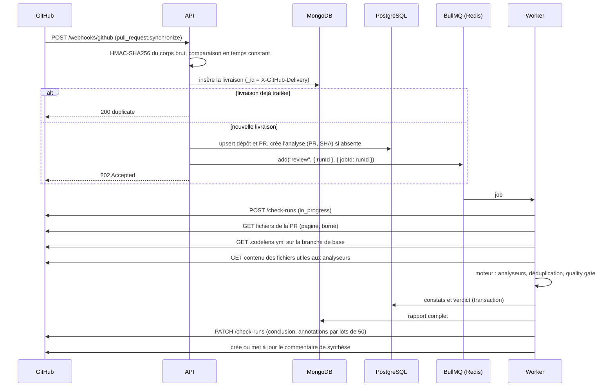

# Pipeline de revue

## De l'événement au check

## Idempotence

| Niveau      | Clé                                   | Effet d'un doublon                     |
| ----------- | ------------------------------------- | -------------------------------------- |
| Livraison   | `X-GitHub-Delivery` (`_id` MongoDB)   | `200 duplicate`, rien n'est enfilé     |
| Analyse     | unicité `(pull_request_id, head_sha)` | la même analyse est réutilisée         |
| Job         | `jobId = runId`                       | BullMQ ignore un job déjà présent      |
| Commentaire | marqueur `<!-- codelens:summary -->`  | le commentaire existant est mis à jour |

GitHub peut rejouer une livraison (bouton « Redeliver » ou reprise après un timeout) : elle porte le
même identifiant. Une livraison dont l'enfilage a échoué n'est pas marquée traitée : le rejeu la
reprend.

## Erreurs et reprises

- Erreur réseau ou `5xx` de GitHub : nouvelle tentative avec attente exponentielle (3 essais).
- Limite de débit atteinte (`403` ou `429` avec `x-ratelimit-remaining: 0`) : la file est mise en
  pause jusqu'à `x-ratelimit-reset`, sans consommer de tentative.
- Échec définitif : l'analyse passe `failed` et le check se termine en **`neutral`** avec un message
  d'excuse. Une panne de CodeLens ne bloque jamais une fusion ([ADR 0005](../adr/0005-moteur-d-analyse-pur-et-extensible.md)).
- Configuration invalide : check `neutral` qui liste les erreurs de `.codelens.yml`.

## Bornes

| Borne                               | Valeur | Au-delà                                          |
| ----------------------------------- | ------ | ------------------------------------------------ |
| Taille d'un webhook                 | 1 Mo   | `413`                                            |
| Fichiers analysés par PR            | 300    | rapport marqué partiel                           |
| Fichiers dont le contenu est chargé | 50     | analyse de complexité limitée aux premiers       |
| Taille d'un fichier chargé          | 200 Ko | fichier ignoré par les analyseurs de contenu     |
| Longueur d'une ligne analysée       | 1 000  | ligne ignorée (code minifié, données)            |
| Annotations publiées                | 200    | les plus graves d'abord, le reste dans le résumé |
