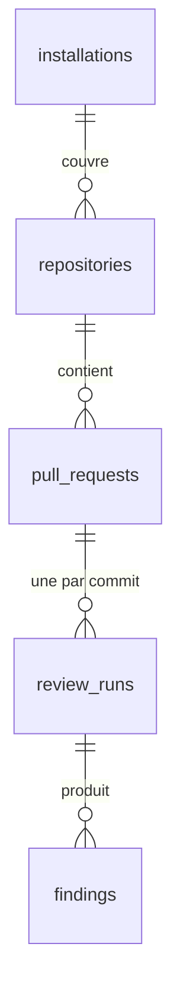

# Modèle de données

## PostgreSQL — données relationnelles et tendances

| Table           | Clé                       | Contenu                                                                 |
| --------------- | ------------------------- | ----------------------------------------------------------------------- |
| `installations` | `id` (identifiant GitHub) | Compte (`account_login`, `account_type`), suspension, désinstallation   |
| `repositories`  | `id` (identifiant GitHub) | `full_name`, visibilité, branche par défaut, retrait de l'installation  |
| `pull_requests` | `id` (identifiant GitHub) | Numéro, titre, auteur, état, brouillon, branches, dernier SHA           |
| `review_runs`   | `id` (UUID)               | Statut, verdict de la gate, compteurs, durée, check run associé, erreur |
| `findings`      | `id` (bigserial)          | Analyseur, règle, sévérité, fichier, ligne, message                     |

Contraintes notables :

- `review_runs (pull_request_id, head_sha)` est **unique** : une seule analyse par commit, ce qui
  rend l'enfilage idempotent.
- Les clés étrangères sont en `ON DELETE CASCADE` : supprimer une installation efface tout ce qui en
  dépend (droit à l'effacement après désinstallation).
- Les identifiants GitHub sont des `bigint` : GitHub a dépassé 2³¹ identifiants de dépôts.
- Index : `repositories (installation_id)`, `review_runs (pull_request_id, queued_at DESC)`,
  `findings (run_id)` et `findings (analyzer)` pour les tendances.

Les migrations SQL sont générées par drizzle-kit depuis `apps/api/src/infrastructure/schema.ts`,
relues en pull request et appliquées par `pnpm db:migrate` avant le démarrage de l'API.

## MongoDB — documents bruts

| Collection           | `_id`                 | Contenu                                                  | Rétention |
| -------------------- | --------------------- | -------------------------------------------------------- | --------- |
| `webhook_deliveries` | `X-GitHub-Delivery`   | Événement, action, installation, statut, payload brut    | 7 jours   |
| `review_reports`     | identifiant d'analyse | Configuration effective, durée et constats par analyseur | 90 jours  |

Pourquoi deux bases : voir l'[ADR 0004](adr/0004-postgresql-et-mongodb.md). Le rapport complet a
une forme qui varie avec les analyseurs ; il est lu en entier et jamais filtré. Les constats utiles
au tableau de bord sont, eux, dans PostgreSQL.

## Redis

| Clé                   | Contenu                                               | TTL             |
| --------------------- | ----------------------------------------------------- | --------------- |
| `bull:reviews:*`      | File BullMQ (jobs, états, limiteur de débit)          | géré par BullMQ |
| `session:<sha256>`    | Session du tableau de bord                            | 8 h             |
| `oauth:state:<state>` | `state` et vérificateur PKCE d'une connexion en cours | 10 min          |
