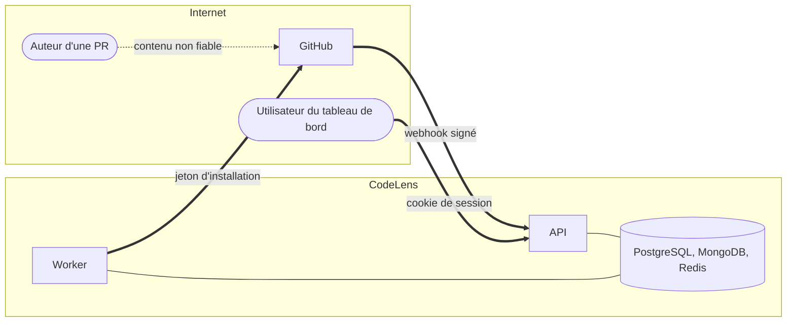

# Modèle de menaces (STRIDE)

## Actifs

| Actif                              | Pourquoi il compte                                                       |
| ---------------------------------- | ------------------------------------------------------------------------ |
| Clé privée de la GitHub App        | Permet d'agir sur **tous** les dépôts de toutes les installations        |
| Secret des webhooks                | Permet de forger des événements et de déclencher des actions             |
| Jetons d'installation (1 h)        | Lecture du code et écriture des checks sur les dépôts d'une installation |
| Jetons OAuth des utilisateurs      | Agissent au nom d'un développeur sur GitHub                              |
| Code et constats des dépôts privés | Un constat révèle une faiblesse (injection, secret) à qui le lit         |
| Secrets détectés dans les PR       | Les recopier les diffuserait plus largement que le commit d'origine      |

## Frontières de confiance

Le contenu d'une PR (code, titre, `package.json`, chemins de fichiers) est **contrôlé par un
attaquant potentiel**, y compris sur un dépôt public ouvert aux contributions externes.

## Menaces et mesures

| ID  | STRIDE                 | Menace                                                      | Mesures                                                                                                    |
| --- | ---------------------- | ----------------------------------------------------------- | ---------------------------------------------------------------------------------------------------------- |
| S1  | Spoofing               | Webhook forgé déclenchant des analyses ou des écritures     | HMAC-SHA256 sur le corps brut, `timingSafeEqual`, vérification avant tout parsing JSON                     |
| S2  | Spoofing               | Rejeu d'une livraison capturée                              | Dédoublonnage par `X-GitHub-Delivery` ; un rejeu ne fait que relancer une analyse idempotente              |
| S3  | Spoofing               | Vol de session du tableau de bord                           | Identifiant opaque de 256 bits, empreinte SHA-256 dans Redis, cookie `HttpOnly` `Secure` `SameSite=Lax`    |
| S4  | Spoofing               | CSRF sur le flux OAuth (connexion au compte de l'attaquant) | Paramètre `state` aléatoire lié au navigateur, PKCE `S256`, `state` à usage unique                         |
| T1  | Tampering              | PR qui désactive la règle qui la bloquerait                 | `.codelens.yml` lu sur la **branche de base**, jamais sur la branche de la PR                              |
| T2  | Tampering              | Code malveillant exécuté pendant l'analyse                  | Le code n'est jamais exécuté ni installé : parsing syntaxique seul, sans résolution de modules             |
| T3  | Tampering              | Injection Markdown dans le commentaire (chemins, messages)  | Chemins et extraits échappés ; aucun lien construit à partir d'une donnée non validée                      |
| R1  | Repudiation            | Contester qu'une analyse a eu lieu ou ce qu'elle a vu       | Livraison brute conservée 7 jours, rapport complet 90 jours, logs corrélés par livraison et par analyse    |
| I1  | Information disclosure | Lecture des constats d'un dépôt privé par un tiers          | Accès vérifié par dépôt via l'API GitHub de l'utilisateur ; dépôt inaccessible : `404`, pas `403`          |
| I2  | Information disclosure | Secret détecté recopié dans un commentaire, un log, la base | Seuls le type, l'emplacement et une empreinte tronquée sont conservés ; tests dédiés                       |
| I3  | Information disclosure | Fuite de la clé privée ou d'un jeton                        | Clé lue depuis un secret monté, jamais loggée (redaction Pino), jetons d'installation en mémoire seulement |
| D1  | Denial of service      | Inondation de webhooks                                      | Corps limité à 1 Mo, signature vérifiée avant parsing, accusé immédiat, travail déporté dans la file       |
| D2  | Denial of service      | PR géante qui monopolise le worker                          | Bornes sur les fichiers, les tailles et les annotations ; concurrence du worker limitée                    |
| D3  | Denial of service      | Ligne piégée provoquant un ReDoS                            | Expressions sans retour arrière ambigu, lignes de plus de 1 000 caractères ignorées, tests de durée        |
| D4  | Denial of service      | Épuisement du quota de l'API GitHub                         | Limiteur BullMQ calé sur `x-ratelimit-reset`, pagination bornée, aucun appel par ligne                     |
| E1  | Elevation of privilege | Permissions excessives de l'application                     | `contents:read`, `pull_requests:write`, `checks:write`, `metadata:read` uniquement                         |
| E2  | Elevation of privilege | SSRF via une URL d'API fournie par un événement             | URL de l'API GitHub fixée par la configuration, jamais lue dans un payload                                 |
| E3  | Elevation of privilege | Dépendance compromise                                       | Lockfile, actions épinglées par SHA, Dependabot, Trivy, CodeQL, revue des dépendances en PR                |

## Risques résiduels acceptés

| Risque                                                         | Raison                                        | Plan                                   |
| -------------------------------------------------------------- | --------------------------------------------- | -------------------------------------- |
| Faux négatifs des détecteurs de secrets                        | Détection par motifs, pas d'analyse de flux   | Secret scanning GitHub en complément   |
| Accès retiré sur GitHub visible jusqu'à 10 min plus tard       | Liste des dépôts accessibles mise en cache    | Webhook `member` pour invalider (v2)   |
| Un administrateur de la branche de base peut assouplir la gate | C'est son rôle ; le changement passe en revue | Audit des changements de configuration |
